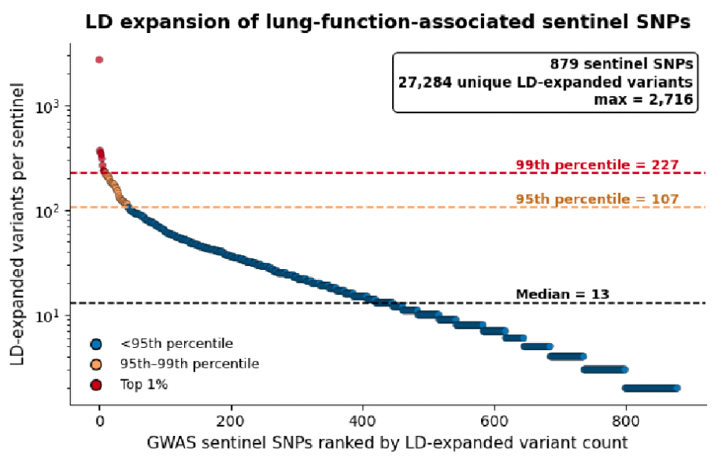

# GWAS LD Proxy Analysis and Statistical Fine-Mapping

## Overview

Genome-wide association studies (GWAS) identify genetic variants associated with complex traits, but sentinel variants may not necessarily be the functional variants underlying these associations. Due to linkage disequilibrium (LD), multiple variants within a genomic region can be correlated with the same GWAS signal. Identifying these correlated variants provides a broader set of candidates for downstream functional genomic analyses.

We performed LD proxy expansion of lung-function-associated sentinel variants reported by Shrine et al. (2023), using PLINK 1.9 and the European ancestry (EUR) subset of the 1000 Genomes Project Phase 3 reference panel. Variants in strong LD (r² ≥ 0.8) within a 1 Mb window of each sentinel variant were retained.

We also performed statistical fine-mapping using SuSiE-RSS to estimate posterior inclusion probabilities (PIPs) and identify credible sets of candidate causal variants within GWAS-associated regions.

## Input Data

`data/1020_rsID_plink_input.txt` contains 1,020 lung-function-associated sentinel variant identifiers from Supplementary Table 6 of Shrine et al. (2023), reconstructed from the matched and unmatched sentinel lists of the original PLINK analysis.

`data/icgcukb_b38_070825.with_hg19_coords.tsv.gz` contains GWAS summary statistics with GRCh37/hg19 coordinates generated using CrossMap. The compressed file is stored using Git LFS.

Both analyses use the 1000 Genomes Phase 3 EUR genotype reference panel. The chromosome-specific PLINK reference files (`.bed`, `.bim`, `.fam`) are not included in this repository.

Reference resources: [PLINK 2.0](https://www.cog-genomics.org/plink/2.0/resources) | [1000 Genomes Project](https://doi.org/10.1038/nature15393)

## 1. LD Proxy Expansion

### Methods

LD proxy identification was performed using chromosome-specific PLINK binary genotype files from the 1000 Genomes Phase 3 EUR reference panel.

| Parameter | Setting |
|---|---|
| Software | PLINK 1.9 |
| LD reference | 1000 Genomes Phase 3 EUR |
| Genome assembly | GRCh37/hg19 |
| LD threshold | r² ≥ 0.8 |
| Genomic window | 1,000 kb |
| Chromosomes | 1–22 |

The analysis script is available at `plink_scripts/run_plink_ld_proxy_expansion.sbatch`.

### Results

Of the 1,020 GWAS sentinel variants, 879 were represented in the EUR reference panel and used for LD expansion.

| Metric | Result |
|---|---:|
| Input GWAS sentinel variants | 1,020 |
| Sentinels matched to the EUR reference | 879 |
| Unmatched sentinel variants | 141 |
| Unique sentinel and LD proxy variants | 27,332 |
| Median LD-linked variants per sentinel | 13 |
| 95th percentile | 107 |
| 99th percentile | 227 |
| Maximum LD-linked variants for a single sentinel | 2,716 |

The figure below shows the distribution of LD-linked variant counts across the 879 reference-matched GWAS sentinel SNPs, ranked from the largest to the smallest LD neighborhood.

LD neighborhood sizes varied substantially across GWAS signals. The median sentinel SNP was associated with 13 LD-linked variants, indicating that most GWAS signals expanded to relatively small sets of correlated variants. At the 95th percentile, a sentinel SNP had 107 LD-linked variants, meaning approximately 95% of sentinel SNPs had 107 or fewer linked variants, while the remaining 5% had larger LD neighborhoods. Similarly, the 99th percentile was 227 variants, indicating that approximately 1% of sentinel SNPs had more than 227 linked variants.

The largest LD neighborhood contained 2,716 variants linked to a single sentinel SNP. This variation illustrates that LD expansion can produce markedly different numbers of candidate variants across GWAS loci, with some association signals spanning substantially larger sets of correlated variants than others.

### Output Files

The PLINK results are available in `results/plink_output/`.

| File | Description |
|---|---|
| `LDproxy_1000G_EUR_r2ge0.8_win1000kb.allchr.ld` | Pairwise LD results containing SNP pairs and r² values |
| `proxies_r2ge0.8.txt` | Unique LD proxy variants |
| `sentinels_plus_proxies_r2ge0.8.txt` | Combined set of matched sentinel and proxy variants |
| `matched_sentinels_in_reference.txt` | Sentinel variants present in the EUR reference |
| `missing_sentinels_not_in_reference.txt` | Sentinel variants absent from the EUR reference |
| `counts.txt` | Summary of variant counts |
| `warnings.txt` | Processing warnings |

## 2. Statistical Fine-Mapping Using SuSiE

### Methods

Statistical fine-mapping was performed using SuSiE-RSS (`susieR`) to identify candidate causal variants within lung-function-associated GWAS regions.

The 879 sentinel variants matched to the EUR reference panel were used to define genomic regions. Each sentinel was extended by ±1 Mb, and overlapping windows were merged to create non-overlapping fine-mapping loci.

For each locus, GWAS summary statistics were extracted using GRCh37/hg19 coordinates. SNPs were matched to the 1000 Genomes Phase 3 EUR genotype reference, and locus-specific signed LD correlation matrices were calculated using PLINK 1.9.

SuSiE-RSS was used to estimate variant-level posterior inclusion probabilities and identify credible sets of variants representing potential independent association signals.

| Parameter | Setting |
|---|---|
| Fine-mapping software | SuSiE-RSS (`susieR`) |
| LD calculation | PLINK 1.9 |
| LD reference | 1000 Genomes Phase 3 EUR |
| Genome assembly | GRCh37/hg19 |
| Locus definition | ±1 Mb around matched sentinel SNPs |
| Overlapping loci | Merged |
| Maximum effects (`L`) | 10 |
| Residual variance estimation | Disabled |
| Main outputs | PIPs and credible sets |

### Analysis Scripts

The scripts are available in `Susie_scripts/`.

| Script | Description |
|---|---|
| `make_1mb_loci.sh` | Defines and merges ±1 Mb windows around sentinel variants |
| `run_ld_susie_all_loci.sbatch` | Extracts locus-specific GWAS statistics and generates LD matrices |
| `run_susie_all_loci.R` | Runs SuSiE-RSS and calculates PIPs and credible sets |
| `submit_susie_all_loci.sbatch` | SLURM submission script for the R analysis |

The scripts use chromosome-specific 1000 Genomes EUR reference files and the GWAS summary statistics provided in `data/`. The compressed GWAS file must be decompressed before use.

### Results

Fine-mapping results are available in `results/Susie_output/`.

The analysis provides SNP-level posterior inclusion probabilities, credible-set assignments, and summaries of fine-mapping results for each locus.

| Output | Description |
|---|---|
| `loci_susie_pip_tables/` | Per-locus SNP-level PIPs and credible-set assignments |
| `loci_susie_summary_tables/` | Per-locus summaries, including the highest-PIP variant and number of credible sets |
| `loci_susie_rds/` | Saved SuSiE model objects |
| `loci_susie_cs_pip0.1.hg19.bed` | Fine-mapping variants represented as GRCh37/hg19 BED intervals |
| `loci_susie_cs_pip0.1.hg38.bed` | Corresponding GRCh38/hg38 BED intervals |

The BED files provide genomic coordinates for downstream integration with functional genomic annotations.

## References

1. Shrine, N. et al. (2023). Multi-ancestry genome-wide association analyses improve resolution of genes and pathways influencing lung function and chronic obstructive pulmonary disease risk. *Nature Genetics*. https://doi.org/10.1038/s41588-023-01314-0
2. The 1000 Genomes Project Consortium (2015). A global reference for human genetic variation. *Nature*, 526, 68–74. https://doi.org/10.1038/nature15393
3. Chang, C. C. et al. (2015). Second-generation PLINK: rising to the challenge of larger and richer datasets. *GigaScience*, 4, 7. https://doi.org/10.1186/s13742-015-0047-8
4. Wang, G. et al. (2020). A simple new approach to variable selection in regression, with application to genetic fine mapping. *Journal of the Royal Statistical Society: Series B*, 82, 1273–1300. https://doi.org/10.1111/rssb.12388
5. Zou, Y. et al. (2022). Fine-mapping from summary data with the "Sum of Single Effects" model. *PLOS Genetics*, 18, e1010299. https://doi.org/10.1371/journal.pgen.1010299
